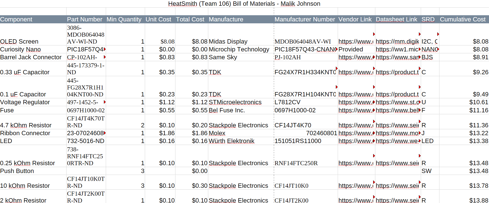

## Overview
The Bill of Materials (BOM) pictured below provides a list of items needed for the construction of my portion of the HeatSmith device.

## Bill of Materials 

</img>

The BOM as a PNG image is available [*here*](https://github.com/Malik-Johnson/Malik-Johnson_EGR304_F26.github.io/blob/ebce757dcd180c3adbcc4c8ac7ae950eeb293959/docs/03-BOM/BOMScreenshot.png), and a Microsoft Excel Sheet [*here*](https://github.com/Malik-Johnson/Malik-Johnson_EGR304_F26.github.io/blob/ebce757dcd180c3adbcc4c8ac7ae950eeb293959/docs/03-BOM/HS-BOM-MJ.xml).
