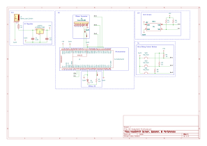

## Overview

The schematic shown below (available as a pdf [*here*](/docs/04-Schematic/HS-Subsystem-MJ-Schematic2.pdf) and archived [*here*](/docs/06-PCB-Design/HS-Subsystem-MJ-Archive.zip) is designed to support the user-interaction features of the HeatSmith device, featuring the digital user interface and the heat alarm speaker. The buttons are attached to pull-up resistors to support software on the Curiosity Nano device, while the speaker and OLED screen are controlled via a transistor and an IC2 connection by that same device. The buttons are also usable as debugging features, alongside the debug LED and the internal Curiosity Nano LED (tied to RE0). The design's power comes from two linear voltage regulators attached to a coaxial power connection (presumably connected through a DC adapted to an outlet) and the design connects to the sensors by means of an 8-pin ribbon connection (though only the digital pins, 1 and 2, are in use).

</img>
**Figure above:** Showing the schematic in question.
