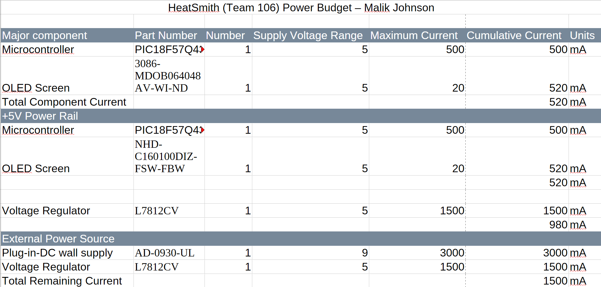

## Overview
The power budget pictured below is a document describing the power limitations and contributions of my portion of the HeatSmith device.

</img>

## Conclusions
Given the relatively small consumption of both the microcontroller and the OLED screen (0.52 A in total), the consumption of my portion of the HeatSmith device should fit comfortably within our overall power budget.

## Resouces

The power budget as a PDF download is available [*here*](https://github.com/Malik-Johnson/Malik-Johnson_EGR304_F26.github.io/blob/b82ce0dec47bd05ea8a5425a89fe8c7994c4af2d/docs/05-Power-Budget/HS-PowerBudget-MJ.pdf), and a Microsoft Excel Sheet [*here*](https://github.com/Malik-Johnson/Malik-Johnson_EGR304_F26.github.io/blob/b82ce0dec47bd05ea8a5425a89fe8c7994c4af2d/docs/05-Power-Budget/HS-PowerBudget-MJ.xml).
