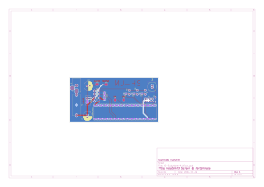

## Overview
The PCB design depicted below connects the components of the design correctly with regard to the schematic.

</img>

## Conclusions
The design is very simple, featuring only connectors for the buttons, LCD screen, and to other portion(s) of the HeatSmith device, as well as a power supply.

## Resouces

The PCB as a PDF download is available [*here*](/docs/06-PCB-Design/HS-Subsystem-MJ-PCB.pdf), and as a Gerber archive [*here*](/docs/06-PCB-Design/HS-Subsystem-MJ-Archive.zip).
